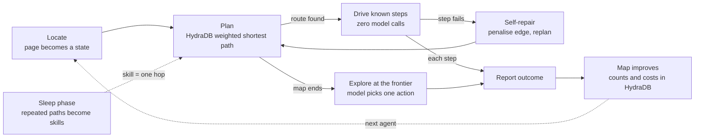

# Atlas

**The route-planning layer for browser agents: steps the map already knows are served from the map, with no model call to pick them.**

Atlas is a route-planning and context layer for browser agents, built on HydraDB. It plans routes over the sites it has mapped, and it asks a model to explore only where the map ends.


**Try it live: <https://hydradb.yashdynamo.fun>** (a self-hosted synthetic test site)

### Why it matters

- **Known steps cost no model calls.** Atlas keeps what agents learn about a site as a graph in HydraDB and
  plans each task as one weighted shortest-path query. The model is asked only where the map ends.

## How it works



Edge cost is `-ln((ok + 1) / (ok + fail + 2)) + ms / 10000`, so reliable, fast edges are cheap. Task values
such as an order number are stored as `{slot}` placeholders, so a route learned for one order serves any
other. Details: [docs/architecture.md](docs/architecture.md).

## Use it

### MCP server

Runner mode: Atlas drives a browser session for the agent.

| Tool | Purpose |
|---|---|
| `atlas_find_skills` | Goals and skills the map can already drive for this site |
| `atlas_run` | Start a goal; drives known steps, returns choices where the map ends |
| `atlas_act` | Take one offered choice, or report that the goal is reached |
| `atlas_recall` | Recall known entities (for example an order) and plan to them |

Planner mode (`MCP_MODE=planner`) is for agents that already have a browser tool; it adds `atlas_plan` and
`atlas_report`. Responses are capped at 400 tokens and never contain HTML or a full accessibility tree.

Hosted server (no install): `https://atlas.yashdynamo.fun/mcp`, streamable HTTP, bearer key from
`POST /v1/keys`. Agents that read only [llms.txt](https://atlas.yashdynamo.fun/llms.txt) can set it up from there.
The flow is two calls on a repeat task:

1. `atlas_plan` with the site, the current page (url and title are enough) and the goal. It returns a `plan_id`
   and one of: an `open_url` to navigate to, a Playwright replay script, or a step-by-step route.
2. `atlas_report` after the task. Send the steps taken in one batch (up to 12), or for a replayed plan just
   `plan_id` and `done`. `ok` is optional. Atlas learns from it; blocked and error pages are never learned.

Page identity is tolerant: a page that changed a banner or a list still matches its known state. Goals match
by exact text, then by the same words, then by a one-slot match (for example a different person's name).
Similar wording is only suggested, and the agent confirms it. Tool definitions are kept under 2,500 tokens.

Claude Desktop, Cursor and other stdio clients: run `python` from an environment where `atlas` is installed
(the project's `.venv`).

```json
{
  "mcpServers": {
    "atlas": {
      "command": "python",
      "args": ["-m", "atlas.mcp"],
      "env": {
        "MCP_MODE": "runner",
        "MCP_SITE": "testmart",
        "TESTMART_URL": "http://127.0.0.1:8100",
        "HYDRADB_URL": "bolt://127.0.0.1:7687",
        "HYDRADB_TOKEN": "<your HydraDB token>"
      }
    }
  }
}
```

Streamable HTTP instead (requires `ATLAS_API_KEY`, sent as a bearer token):

```bash
python -m atlas.mcp --http --host 127.0.0.1 --port 8200   # endpoint: http://127.0.0.1:8200/mcp
```

### Route API

Stateless HTTP with a bearer key. The integration is three calls, shown against a local API:

```bash
API=http://127.0.0.1:8000
AUTH="Authorization: Bearer $ATLAS_API_KEY"

# 1. where am I? (snapshot = URL plus interactive elements as role and name)
curl -s -X POST $API/v1/locate -H "$AUTH" -H "Content-Type: application/json" -d '{
  "site": "testmart",
  "snapshot": {"url": "http://127.0.0.1:8100/orders", "elements": [{"role": "link", "name": "Orders"}]}}'
# -> {"state_id": ..., "known": true}

# 2. cheapest known route to the goal (state_id from step 1)
curl -s -X POST $API/v1/plan -H "$AUTH" -H "Content-Type: application/json" -d '{
  "site": "testmart", "state_id": <state_id>,
  "goal_text": "Refund order 1042", "params": {"order_id": "1042"}}'
# -> {"route": [...], "confidence": ..., "needs_model": false, "reason": ...}

# 3. report what happened after one action
curl -s -X POST $API/v1/report -H "$AUTH" -H "Content-Type: application/json" -d '{
  "site": "testmart", "from_state": <state_id>,
  "action": {"kind": "click", "locator": {"role": "link", "name": "Orders"}},
  "to_snapshot": {"url": "http://127.0.0.1:8100/orders", "title": "Orders", "elements": []},
  "ok": true, "ms": 120, "event_id": "run-1-step-0"}'
```

For a whole run in two calls, `POST /v1/start` (site, snapshot, goal, params) returns a plan, and
`POST /v1/finish` (the plan id and the outcome) records it. The Python SDK uses exactly these.

An empty `route` with `"needs_model": true` means you are at the edge of the map: explore one step, report
it, and plan again. Also: `GET /v1/map/{site}`, `GET /v1/changes?site=`, `GET /v1/skills?site=`,
`POST /v1/sleep?site=`, `GET /healthz`. Models: `atlas/contracts/api_models.py`.

### Python SDK

```bash
pip install atlas-route-sdk
```

```python
from atlas_sdk import Atlas

atlas = Atlas("http://127.0.0.1:8000", api_key, site="testmart")
summary = atlas.session(driver).run("Refund order 1042", {"order_id": "1042"}, fallback=my_agent_step)
print(summary)  # RunSummary(success=True, steps=5, map_steps=5, fallback_calls=0)
```

`driver` provides `snapshot()` and `act(action)`. `fallback` is your own agent step, called only where the
map ends. See [sdk/README.md](sdk/README.md) and [sdk/example.py](sdk/example.py).

### Trace import

Recorded agent runs become a map without re-exploring. One `TraceStep` JSON object per line:

```bash
ATLAS_API_URL=http://127.0.0.1:8000 ATLAS_API_KEY=<your key> python -m atlas.import_trace runs.jsonl
```

The whole file is validated before anything is imported. Schema and `TraceRecorder`:
[docs/trace-import.md](docs/trace-import.md).

## Results

### Live run on real sites (2026-11-16)

Real headless Chromium on Wikipedia against the deployed Atlas, with a plain agent as the baseline on the
same model (DeepSeek `deepseek-flash`). Success is checked on the landing URL.

- **Python SDK, known goal, new topic:** 0 model calls in 19 of 19 runs after the first learning run, about
  3.8 s against 9 s for the plain agent. Success 19/20 for both.

## Run locally

Requirements: Docker (with Compose) and Python 3. Three commands:

```bash
git clone https://github.com/YASH-YADAV-dynamo/atlas.git && cd atlas
python scripts/setup.py          # writes .env and the HydraDB token with fresh random secrets
docker compose up -d --build     # HydraDB, the TestMart demo site and the Atlas API
```

Open <http://localhost:8000>. The MCP server is at `http://localhost:8000/mcp`; create a key with
`curl -s -X POST http://localhost:8000/v1/keys`. Port 8000 taken? `ATLAS_PORT=8010 docker compose up -d`.

Planning, reporting and MCP work without any model key. To let agents explore pages the map does not
know yet, put a model key in `.env` (`MODEL_PROVIDER`, `MODEL_API_KEY`, `ATLAS_MODEL_ID`; any
OpenAI-compatible provider works) and run `docker compose up -d` again. Spend is capped by `MODEL_BUDGET_USD`.

Stop with `docker compose down` (add `-v` to wipe the map).

### Develop

Requirements: Python 3.12 or 3.13, GNU make.

```bash
make setup        # .venv, pinned dependencies, Chromium
make check        # lint, types, unit and contract tests
make test-int     # the store contract against real HydraDB (needs the stack above running)
```

## Architecture

- **Core** (`atlas/core/`): pure logic, no I/O. **Ports** (`atlas/contracts/`): types, API and MCP models,
  and the store, browser and model interfaces.
- **Adapters** (`atlas/adapters/`): `hydradb` (all Cypher in `queries.py`), local Playwright, the model.
- **Surfaces**: Route API (`atlas/api/`), MCP (`atlas/mcp/`), runner (`atlas/runner/`), SDK (`sdk/`), demo (`web/`).

Full design: [docs/architecture.md](docs/architecture.md). Decisions: [docs/adr/](docs/adr/).

## License

MIT, see [LICENSE](LICENSE). HydraDB is used unmodified as a separate service under its own licence.

HydraDB: <https://github.com/hydra-db/hydradb>.
